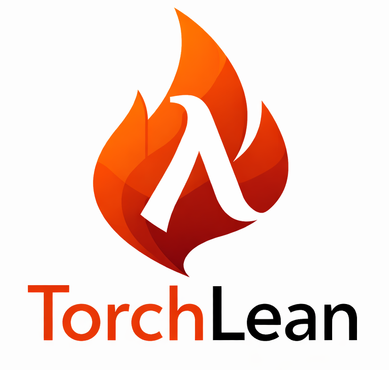

<h1 align="center">
  
  Formalizing Neural Networks in Lean
</h1>

TorchLean brings general tensor computations, machine learning, and mathematical proofs together
in Lean. We can use its shape-checked tensors for linear algebra and numerical algorithms, write
our own tensor functions, or build and train neural networks, from small examples to larger
GPU-backed training runs. Lean is both a functional programming language and a theorem prover,
so we can run a calculation and reason about it in the same language.

We reuse the same tensor or model definition for training, graph transformations, certificate
checks, and proofs. In Lean we can state the property we care about and prove it for that
definition: an algebraic identity, a gradient formula, a symmetry or invariance, the correctness
of a graph rewrite, or that a classifier keeps its prediction across an input region. FloatLib
adds roundoff bounds for a chosen arithmetic format. Each theorem states the assumptions it needs.

On CPU and CUDA, one Lean autograd tape records operators from `TorchLean.Op`, the same table used
for graph lowering and verification. The CPU runs their Lean rules. On CUDA, registered native
model operators use LibTorch ATen, while custom and configured computations use generated kernels.
Both paths record on the same Lean tape.

## Installation

```bash
git clone https://github.com/lean-dojo/TorchLean.git
cd TorchLean
scripts/lake.sh exe cache get
scripts/lake.sh build
```

`scripts/lake.sh build` builds the four libraries `TorchLean.Tensor`, `TorchLean.CUDA`,
`TorchLean.NN`, and `TorchLean.Verify`. To build one layer, name it:
`scripts/lake.sh build TorchLean.Tensor`.

The [installation guide](https://lean-dojo.github.io/TorchLean/installation/) covers Linux, macOS,
Windows/WSL and CUDA with LibTorch, and explains TorchLean's backend architecture.

## Quickstart

```bash
scripts/lake.sh exe torchlean quickstart_mlp --device cpu --steps 50

# Optional CUDA run
export TORCHLEAN_LIBTORCH_HOME=/absolute/path/to/libtorch
scripts/lake.sh -Kcuda=true build
scripts/lake.sh -Kcuda=true exe torchlean quickstart_mlp --device cuda --steps 50
```

The trainer uses `Float32` by default. For binary128 or a custom format, set the scalar type
in the [typed training example](TorchLeanExamples/Quickstart/TypedTraining.lean).

Application code writes concrete tensor types as `Tensor α [dims...]`, with the element type first.
For example, `Tensor Float [4, 2]` is a four-by-two tensor of `Float` values:

```lean
import TorchLean.NN.Data.Dataset
import TorchLean.NN.Trainer.Constructor
import TorchLean.NN.Trainer.Train
open TorchLean
open Trainer.Objective (mse)

/-- A two-layer regression model. The dimensions are checked when the layers are composed. -/
def model :=
  nn.Sequential![
    nn.linear 2 8,
    nn.op .relu,
    nn.linear 8 1
  ]

-- Four input rows, each containing two features.
def xs : Tensor Float [4, 2] :=
  [[0.0, 0.0], [0.0, 1.0], [1.0, 0.0], [1.0, 1.0]]

-- One regression target for each input row.
def ys : Tensor Float [4, 1] :=
  [[0.2], [1.0], [1.0], [1.8]]

-- The leading `4` counts samples; each sample has shapes `[2]` and `[1]`.
def data : Trainer.Dataset [2] [1] := Data.fromTensors xs ys

def trainOnce : IO Unit := do
  let trainer :=
    Trainer.create model
      { objective := mse
        optimizer := optim.sgd { lr := 0.05 } }
  -- Inspect the initialized model before any parameter updates.
  let initialPrediction ← trainer.predict ([0.5, -0.25] : Tensor Float [2])
  IO.println s!"initial={reprStr initialPrediction}"
  -- Each step averages 16 sample gradients at one parameter point, then updates once.
  -- Training returns a result that retains the updated parameters and run report.
  let trained ← trainer.train data { steps := 200, samplesPerStep := 16, logEvery := 25 }
  trained.printSummary
```

### Compile a Python model

From the repository root, install the Python package with `python -m pip install -e python`,
build the checker with `scripts/lake.sh build verify`, and put `@torchlean.compile` on a model
class:

```python
import torch
import torchlean

@torchlean.compile
class MLP(torch.nn.Module):
    def __init__(self):
        super().__init__()
        self.layers = torch.nn.Sequential(
            torch.nn.Linear(2, 8), torch.nn.ReLU(), torch.nn.Linear(8, 1)
        )

    def forward(self, inputs):
        return self.layers(inputs)

model = MLP()
batch = torch.ones(32, 2)
prediction = model(batch)
prediction.sum().backward()
print(model.torchlean.report["ok"])
```

TorchLean detects PyTorch or JAX automatically. The first call captures the computation for the
whole batch and checks its IR structure and types. Later compatible calls reuse that graph. There is
no extra loop over samples. PyTorch or JAX runs the captured computation itself, on the same device
and with its own automatic differentiation. Use the same decorator on an ordinary PyTorch or JAX
function, or use `model = torchlean.compile(model)` for a constructed PyTorch module, whose
parameters and training methods remain available. For a class that overrides `__call__`, put the
decorator on the class. Unsupported captures and failed checks raise an error.

These checks are about the imported graph. They don't prove that it matches the Python program, or
that it is correct on every input. The
[captured-computation guide](https://lean-dojo.github.io/TorchLean/examples/verify/) covers graph
inspection, sample comparisons and Lean proof exports.

An [optional Python binding](bindings/python/README.md) runs the same checker inside the Python
process. `torchlean.compile` and `torchlean.verify` have the same interface with or without it.

## Commands

```bash
scripts/lake.sh exe torchlean --help
scripts/lake.sh exe verify --help
scripts/lake.sh exe verify -- torchlean-ibp
```

For the maintained examples:

```bash
scripts/lake.sh build TorchLeanExamples
```

## Use TorchLean From Another Lean Project

TorchLean is a normal Lake package. You can depend on the Git repository directly:

```lean
require TorchLean from git "https://github.com/lean-dojo/TorchLean.git" @ "main"
```

Then run from the downstream project's root, using its own Lake configuration:

```bash
lake update
lake exe cache get
lake build
```

Model, data and training code imports the modules of the application API that define what it uses,
as the quickstart above does. [`TorchLean/NN`](TorchLean/NN/README.md) holds `TorchLean.nn`,
`TorchLean.Data`, `TorchLean.Trainer` and `TorchLean.optim`. Import `TorchLean.Verify.Trainer`
to call `trained.verify center (radius := r)` after ordinary training, and
`TorchLean.Verify.Lowering` to lower a model to a verifier graph yourself.

### Choosing layers

A project that requires TorchLean and imports only `TorchLean.Tensor.*` modules compiles against
FloatLib and Mathlib and links only the CPU tensor core, `csrc/cpu/torchlean_tensor.c`, with the
pinned allocator on Linux. Once its imports reach `TorchLean.CUDA`, as the quickstart's imports
do, an executable also links the stub compiled from `csrc/libtorch/unavailable.c`, which reports
the GPU backend as not linked. Setting the Lake option `cuda` to `true` links the LibTorch backend
in its place: `-Kcuda=true` when building TorchLean itself, or the `with` clause of `require` in
a project that depends on it.

### Custom tensor computations

We can write a scalar calculation as an ordinary Lean function, apply it to a tensor, and choose
the execution device at the call site:

```lean
import TorchLean.NN.Kernel.Function
open TorchLean

def square := fun (x : Float32) => x * x

def input : Tensor Float32 [3] := Tensor.ofFn fun i => Float32.ofNat (i.val + 1)
def onCpu : IO (Tensor Float32 [3]) := square.run input (device := .cpu)
def onGpu : IO (Tensor Float32 [3]) := square.run input (device := .cuda)

#eval square.run input (device := .cpu)
-- [1.000000, 4.000000, 9.000000]
```

CPU is the default and runs the Lean function itself. On GPU, supported calculations compile
through NVRTC, with native FP32/FP64 or configured binary arithmetic. A scalar type or format that
only the CPU supports runs on CPU at its own precision, with a diagnostic. Unsupported code for a
GPU-capable type, or an unavailable GPU, returns an error. Functions can take runtime scalar
parameters, and `f.zip left right` combines two tensors of the same shape. Indexed programs
support bounded loops and fixed-parameter numerical recurrences, with a Lean-checked
correspondence to the recursive equations. Whole-tensor functions use the same call,
`f.run input`. Add `(grad := true)` to record supported operations on the autograd tape. Such a
result has `.value` and `.backward`. Shapes and storage are inferred from the input.
The tape does not record arbitrary indexed bodies, and `Program.gradient` compiles their
gradients into kernels, proved over the reals. The
[custom-operation guide](TorchLean/NN/Kernel/README.md) and the
[CUDA compiler guide](TorchLean/CUDA/Kernel/README.md) cover the supported operations, indexed
programs, lowering proofs and the native execution boundary.

### Proved gradients

Except for `custom`, the operator table supplies a forward map and backward rule where the scalar
has the required capabilities. Where registered, real-valued derivative certificates prove that
the backward rule is the adjoint of the Fréchet derivative under the stated domain hypotheses. At
a kink, a convention certificate states the selected rule. `#op_certs Op.relu` lists the
certificates for ReLU.

The `op_deriv` tactic checks a handwritten backward pass against its forward definition. These are
real-arithmetic results; rounding error needs a separate bound. The
[derivative guide](TorchLean/NN/Tactic/README.md#backward-passes) gives examples and side conditions.

### Recursion over trees

`TorchLean.CUDA.Tree` runs structurally recursive functions over inductive types on the GPU.
Derive `Sig.Inductive` for the type, then use `Fold.of` on the Lean function. The compiler stores
the tree by levels and runs one kernel per level, with a Lean proof that the fold computes the
source function. Hylomorphisms cover recursion whose calls do not follow an input tree, and
unfolds build trees on the GPU.

The [tree guide](TorchLean/CUDA/Tree/README.md) works through a binary-tree sum and explains the
supported recursion, device API and native execution boundary.

### Precision

[FloatLib](https://github.com/lean-dojo/FloatLib) supplies configurable arithmetic and numerical
proofs. Typed CPU tensors and models can use binary32, binary128 or a custom binary format without
converting through native floats. Custom GPU computations use compatible hardware instructions or
integer-limb arithmetic for configured binary formats. The LibTorch tape also records configured
arithmetic, while native model operators and optimizer checkpoints require native dtypes. Decimal
and posit formats run on CPU. See the [custom-operation guide](TorchLean/NN/Kernel/README.md).

FloatLib's `roundoff` tactic reads the Lean code of a numerical operation and proves absolute or
mixed error bounds under explicit assumptions. TorchLean extends it to tensor entries, folds and
operators. Successful analyses produce bound theorems; registration alone does not. The
[numerical runtime example](https://lean-dojo.github.io/TorchLean/examples/numerical-runtime/)
and [runtime approximation guide](TorchLean/Verify/RuntimeApprox/README.md) explain the supported
bounds and the remaining gaps.

Use `Tensor.sumIn` to run the same sum in a left fold, in blocks, or in a pairwise tree.
The IR can store the order for sums, contractions, matrix products, and other reductions.
PyTorch, JAX and ONNX captures record left folds for those operators. The
[reduction-order example](https://lean-dojo.github.io/TorchLean/examples/numerical-runtime/#choosing-a-reduction-order)
shows what changes in binary32 and which bounds apply.

The [typed-training example](TorchLeanExamples/Quickstart/TypedTraining.lean) trains in binary128.
Import `TorchLean.NN.Sequential.Training` for typed graphs and SGD on typed model state, or
`TorchLean.NN.Trainer.Session` for typed trainer sessions.

## Versions and Coverage

TorchLean uses Lean 4.36.0, Mathlib v4.36.0, and FloatLib v4.1.0. The guide and optional Python
binding use the same toolchain and inherit the library's pinned dependencies.

The Python frontend imports supported tensor computations from JAX and PyTorch, including
conditionals, scans and bounded while loops. It preserves element descriptors and explicit
conversions in the artifact. The wire format is version 5; version 4 artifacts need to be
recaptured. Supported types include standard binary floats, float8 formats, fixed-width integers,
Booleans and paired-real complex values. Operation coverage differs by frontend and type.

The [IR guide](TorchLean/NN/IR/README.md) and [PyTorch guide](TorchLean/NN/PyTorch/README.md) give the
supported operations, precision rules, control-flow semantics and refusal cases. The
[trust guide](docs/TRUST_BOUNDARIES.md) separates graph checks, real-valued proofs, numerical bounds
and external execution assumptions.

## Repository Map

- [`TorchLean/Tensor`](TorchLean/Tensor/README.md): shape-indexed tensors and their operations,
  packed CPU storage, scalar formats, mathematical tensor and layer definitions with the operator
  table, proof automation, and tensor proofs.
- [`TorchLean/CUDA`](TorchLean/CUDA/README.md): the LibTorch boundary, the CUDA compiler for
  custom computations, and folds over trees on the GPU.
- [`TorchLean/NN`](TorchLean/NN/README.md): the application API, model and dynamical-system
  specifications, executable autograd, optimizers, training loops, PyTorch import/export, Jaxpr
  graph import, RL runtime support, backend plans, the graph IR, learning theory, and proofs.
- [`TorchLean/Verify`](TorchLean/Verify/README.md): CROWN and IBP, certificate checkers and CLI
  workflows, roundoff proofs, and the floating-point bridges and contracts.
- [`TorchLeanExamples`](TorchLeanExamples/README.md): quickstarts, runnable model examples,
  widgets, bundled verification assets, and interoperability workflows.
- [`TorchLeanTest`](TorchLeanTest/README.md): the tests behind `scripts/lake.sh test`, which check
  TorchLean against PyTorch, LibTorch and CUDA, ONNX, native floating point and outside file
  formats.
- `csrc`: native sources, with the CPU tensor core in `csrc/cpu`, the LibTorch backend and its
  stub in [`csrc/libtorch`](csrc/libtorch/README.md), and the pinned Linux allocator in
  `csrc/runtime`.
- `python/torchlean`: the Python package that compiles PyTorch and JAX graphs to TorchLean IR and
  checks them (`@torchlean.compile`), installed with `python -m pip install -e python`.
- FloatLib dependency: configurable executable formats, reference semantics, rounding proofs,
  and scalar intervals.
- `home_page/blueprint/TorchLeanBlueprint/Guide`: source for the guide.
- `home_page`: project website sources.

## Proofs And Runtime Boundaries

TorchLean proves properties of definitions written in Lean. It also checks certificates produced
by external tools, including bound-propagation and scientific-computing workflows. An executable
certificate check reports that the checker accepted the certificate. A semantic guarantee also
needs the checker's soundness theorem and its hypotheses, and a Lean proof needs kernel-checked
evidence of acceptance. None of these checks certifies the program that produced the certificate.

CPU instructions, CUDA kernels, cuBLAS, LibTorch, PyTorch, Julia and other external systems are
runtime providers. [`docs/TRUST_BOUNDARIES.md`](docs/TRUST_BOUNDARIES.md) lists their interfaces,
their assumptions and the checks available for each.
[`docs/THIRD_PARTY_NOTICES.md`](docs/THIRD_PARTY_NOTICES.md) lists third-party sources and
licenses, and [the AI usage disclosure](docs/CONTRIBUTING.md#ai-usage-disclosure) describes how we
used coding assistants.

The papers, books and standards that the specifications follow are listed in
[docs/REFERENCES.md](docs/REFERENCES.md).

Contribution guidelines are in [docs/CONTRIBUTING.md](docs/CONTRIBUTING.md).

## Citation

If TorchLean is useful in your work, please cite
[*TorchLean: Formalizing Neural Networks in Lean*](https://arxiv.org/abs/2602.22631):

```bibtex
@misc{george2026torchlean,
  title         = {TorchLean: Formalizing Neural Networks in Lean},
  author        = {George, Robert Joseph and Cruden, Jennifer and Adkisson, Will and
                   Zhong, Xiangru and Zhang, Huan and Anandkumar, Anima},
  year          = {2026},
  eprint        = {2602.22631},
  archivePrefix = {arXiv},
  primaryClass  = {cs.MS},
  url           = {https://arxiv.org/abs/2602.22631}
}
```

## License

TorchLean is released under the MIT License. See `LICENSE`.
